# Workers benchmark comparison

Overview of the latest saved benchmark reports. Lower is better except throughput, where higher is better.

## Benchmarks

| Benchmark                                        | Measured (UTC)           | Data                                          |
| ------------------------------------------------ | ------------------------ | --------------------------------------------- |
| [baseline-void](./baseline-void/report.md)       | 2026-11-20T07:51:38.075Z | [report.json](./baseline-void/report.json)    |
| [baseline-workers](./baseline-workers/report.md) | 2026-11-20T08:33:20.371Z | [report.json](./baseline-workers/report.json) |
| [image-gen](./image-gen/report.md)               | 2026-11-20T03:50:21.711Z | [report.json](./image-gen/report.json)        |
| [image-gen-takumi](./image-gen-takumi/report.md) | 2026-11-20T07:23:34.097Z | [report.json](./image-gen-takumi/report.json) |

## Bundle size

### Raw

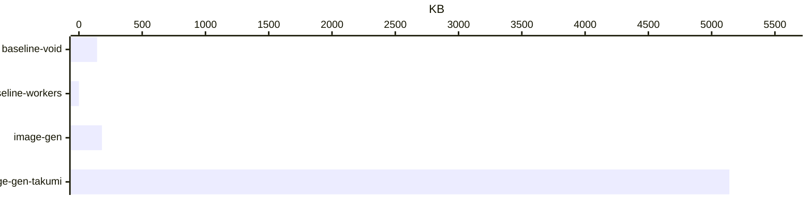

### Gzip

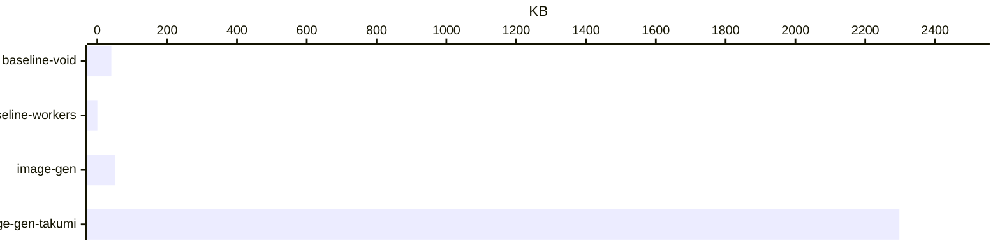

### Details

<details>
<summary>Show details</summary>

#### Values

| Benchmark / workload | Raw          | Gzip        |
| -------------------- | ------------ | ----------- |
| baseline-void        | 143.403 KB   | 40.15 KB    |
| baseline-workers     | 0.187 KB     | 0.161 KB    |
| image-gen            | 181.859 KB   | 51.209 KB   |
| image-gen-takumi     | 5,140.131 KB | 2,297.86 KB |

#### Methodology

Median raw and gzip sizes across successful deployments with recorded sizes, in KB (1 KB = 1,000 bytes). Historical single-deployment reports use the recorded size.

</details>

## Deployment timing

### Build

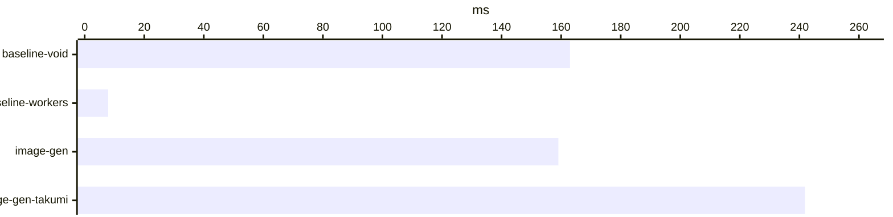

### Upload

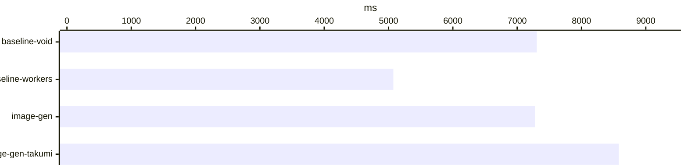

### Worker startup

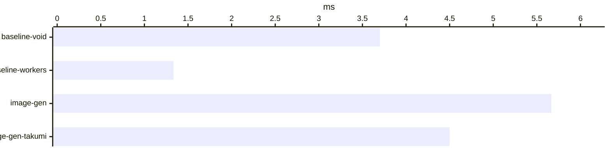

### `cf deploy`

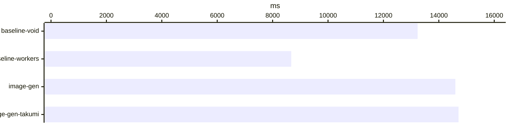

### Details

<details>
<summary>Show details</summary>

#### Values

| Benchmark / workload | Build      | Upload       | Worker startup | `cf deploy`   |
| -------------------- | ---------- | ------------ | -------------- | ------------- |
| baseline-void        | 162.967 ms | 7,304.333 ms | 3.7 ms         | 13,234.209 ms |
| baseline-workers     | 7.9 ms     | 5,075 ms     | 1.333 ms       | 8,671.097 ms  |
| image-gen            | 159.067 ms | 7,276 ms     | 5.667 ms       | 14,595.889 ms |
| image-gen-takumi     | 241.867 ms | 8,579.667 ms | 4.5 ms         | 14,711.211 ms |

#### Methodology

Means across successful deployment runs; historical single-deployment reports use the recorded timing. These phases overlap: do not add them. `cf deploy` includes build but excludes later Worker lookup and Access setup. Worker startup is runtime initialization, not cold-request latency.

</details>

## Latency

### Mean

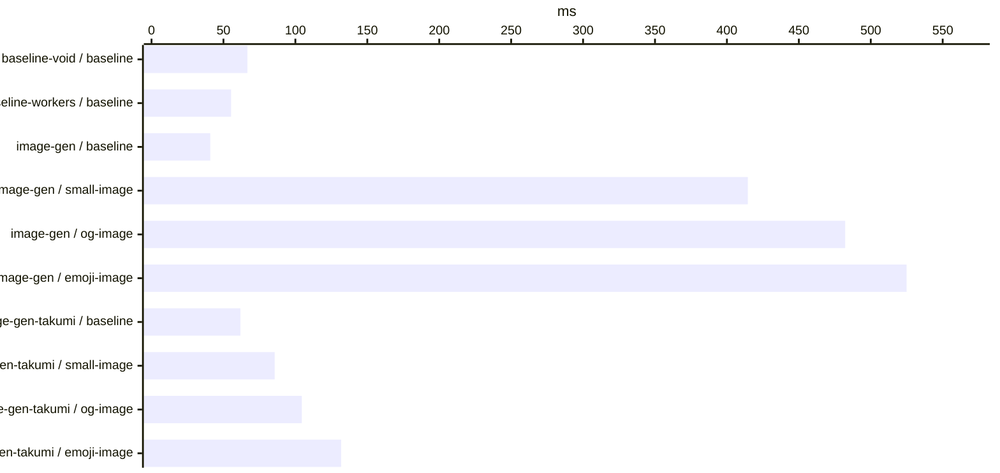

### Minimum

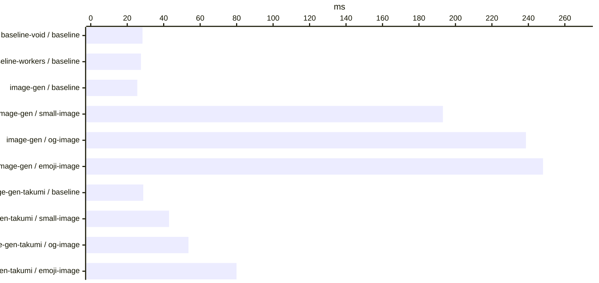

### P50

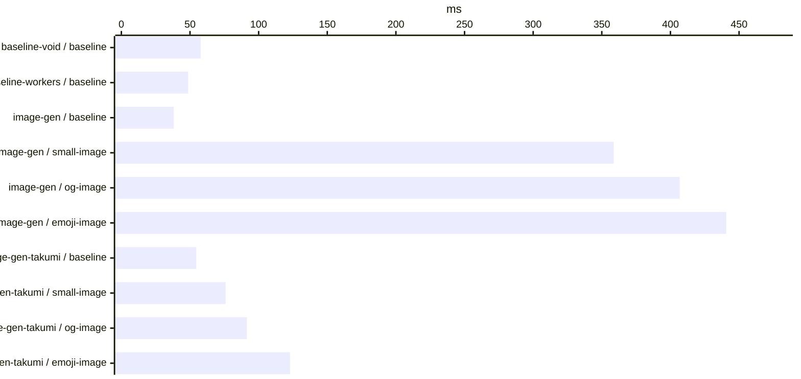

### P95

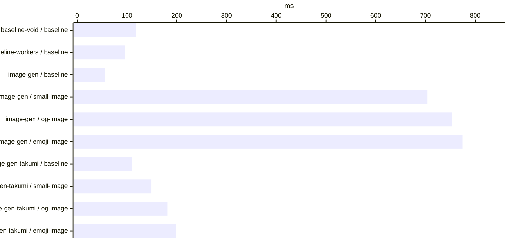

### P99

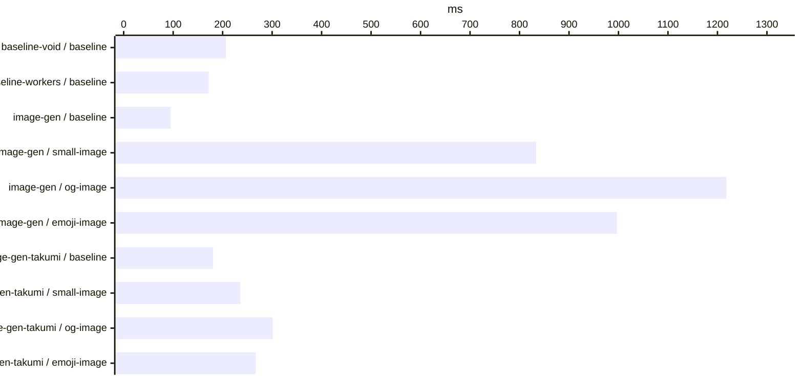

### Maximum

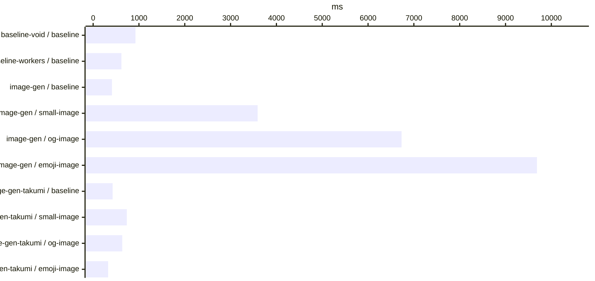

### Throughput

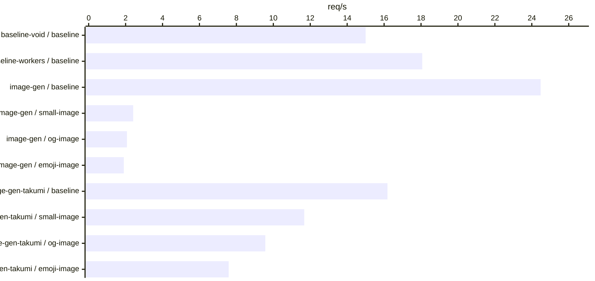

### Details

<details>
<summary>Show details</summary>

#### Values

| Benchmark / workload           | Mean       | Minimum    | P50        | P95        | P99          | Maximum      | Throughput   |
| ------------------------------ | ---------- | ---------- | ---------- | ---------- | ------------ | ------------ | ------------ |
| baseline-void / baseline       | 66.643 ms  | 28.384 ms  | 57.787 ms  | 118.306 ms | 206.603 ms   | 923.248 ms   | 15 req/s     |
| baseline-workers / baseline    | 55.328 ms  | 27.52 ms   | 48.647 ms  | 96.258 ms  | 171.818 ms   | 618.029 ms   | 18.067 req/s |
| image-gen / baseline           | 40.833 ms  | 25.538 ms  | 38.231 ms  | 55.756 ms  | 94.999 ms    | 410.408 ms   | 24.478 req/s |
| image-gen / small-image        | 414.551 ms | 193.138 ms | 358.687 ms | 704.08 ms  | 833.676 ms   | 3,590.542 ms | 2.412 req/s  |
| image-gen / og-image           | 482.197 ms | 238.653 ms | 406.73 ms  | 754.211 ms | 1,217.993 ms | 6,731.583 ms | 2.074 req/s  |
| image-gen / emoji-image        | 524.903 ms | 248.042 ms | 440.607 ms | 774.262 ms | 996.846 ms   | 9,686.835 ms | 1.905 req/s  |
| image-gen-takumi / baseline    | 61.772 ms  | 28.799 ms  | 54.568 ms  | 109.848 ms | 180.87 ms    | 425.892 ms   | 16.183 req/s |
| image-gen-takumi / small-image | 85.63 ms   | 42.933 ms  | 75.928 ms  | 148.773 ms | 235.851 ms   | 735.927 ms   | 11.674 req/s |
| image-gen-takumi / og-image    | 104.485 ms | 53.594 ms  | 91.385 ms  | 181.048 ms | 301.303 ms   | 636.011 ms   | 9.566 req/s  |
| image-gen-takumi / emoji-image | 131.823 ms | 79.939 ms  | 122.896 ms | 198.965 ms | 267.004 ms   | 327.05 ms    | 7.583 req/s  |

#### Methodology

Client latency includes network and Access overhead. Values describe pooled requests where available; throughput at the recorded concurrency is not capacity. Different routes, payloads, connection counts, or request settings are not equivalent workloads.

#### Workload context

| Benchmark / workload           | Request                                                                                                          | Rounds | Requests / duration per round | Connections | Rate limit |
| ------------------------------ | ---------------------------------------------------------------------------------------------------------------- | ------ | ----------------------------- | ----------- | ---------- |
| baseline-void / baseline       | GET /                                                                                                            | 10     | 1,000                         | 1           | None       |
| baseline-workers / baseline    | GET /                                                                                                            | 10     | 1,000                         | 1           | None       |
| image-gen / baseline           | GET /                                                                                                            | 10     | 1,000                         | 1           | None       |
| image-gen / small-image        | GET /run?width=64&amp;height=64                                                                                  | 10     | 250                           | 1           | None       |
| image-gen / og-image           | GET /run?width=1200&amp;height=630                                                                               | 10     | 50                            | 1           | None       |
| image-gen / emoji-image        | GET /run?width=1200&amp;height=630&amp;text=Hello%20%F0%9F%91%8B%20%F0%9F%8C%8D%20%F0%9F%9A%80                   | 10     | 50                            | 1           | None       |
| image-gen-takumi / baseline    | GET /                                                                                                            | 10     | 1,000                         | 1           | None       |
| image-gen-takumi / small-image | GET /run?width=64&amp;height=64                                                                                  | 10     | 250                           | 1           | None       |
| image-gen-takumi / og-image    | GET /run?width=1200&amp;height=630                                                                               | 10     | 50                            | 1           | None       |
| image-gen-takumi / emoji-image | GET /run?width=1200&amp;height=630&amp;text=Hello%20%F0%9F%91%8B%20%F0%9F%8C%8D%20%F0%9F%9A%80&amp;emoji=twemoji | 10     | 50                            | 1           | None       |

</details>

## Worker metrics (P50)

### CPU

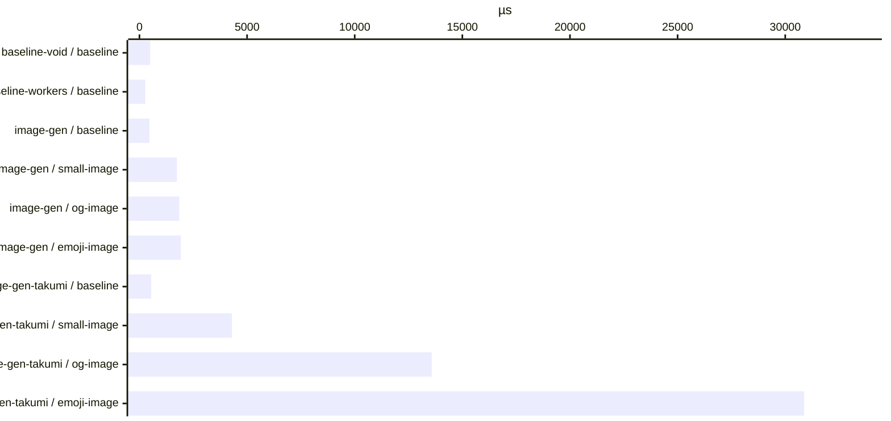

### Wall time

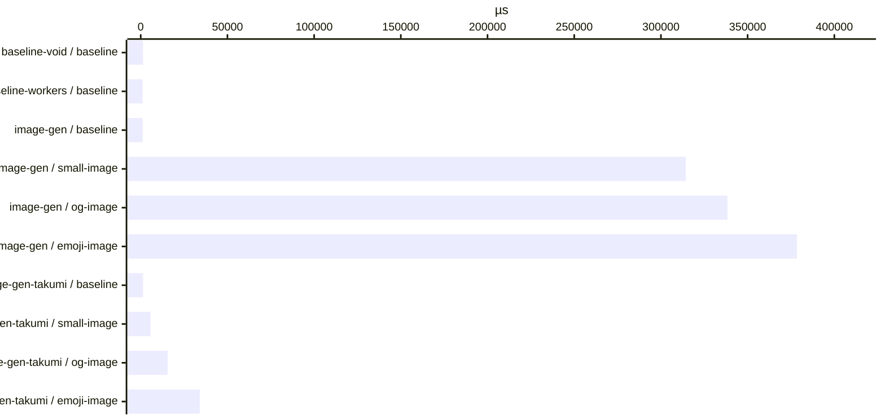

### Isolate memory

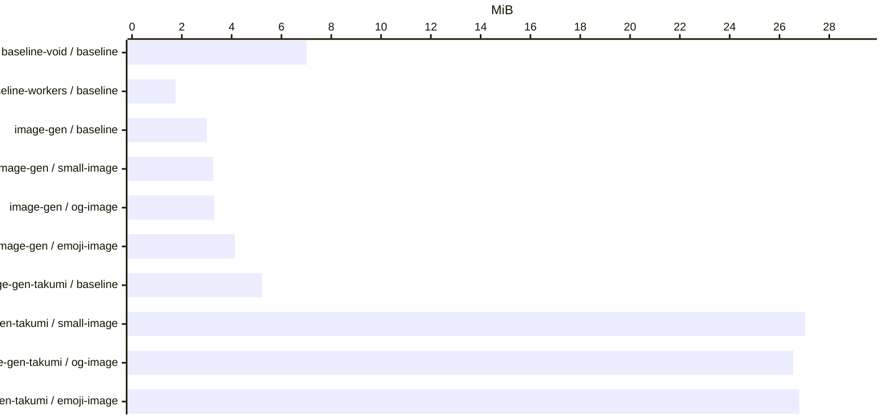

### Details

<details>
<summary>Show details</summary>

#### Values

| Benchmark / workload           | CPU       | Wall time  | Isolate memory |
| ------------------------------ | --------- | ---------- | -------------- |
| baseline-void / baseline       | 501 µs    | 1,325 µs   | 7.008 MiB      |
| baseline-workers / baseline    | 269 µs    | 1,090 µs   | 1.75 MiB       |
| image-gen / baseline           | 464 µs    | 1,117 µs   | 3.004 MiB      |
| image-gen / small-image        | 1,740 µs  | 314,355 µs | 3.263 MiB      |
| image-gen / og-image           | 1,850 µs  | 338,346 µs | 3.295 MiB      |
| image-gen / emoji-image        | 1,923 µs  | 378,420 µs | 4.135 MiB      |
| image-gen-takumi / baseline    | 549 µs    | 1,356 µs   | 5.225 MiB      |
| image-gen-takumi / small-image | 4,298 µs  | 5,642 µs   | 27.028 MiB     |
| image-gen-takumi / og-image    | 13,582 µs | 15,505 µs  | 26.556 MiB     |
| image-gen-takumi / emoji-image | 30,878 µs | 34,039 µs  | 26.798 MiB     |

#### Methodology

CPU excludes time waiting on I/O. Wall time includes I/O waits and `waitUntil()` work, not client response time. Memory is shared isolate usage, not per-request allocation or peak memory. Quantiles are sampled across each Worker and its padded measurement window, including warmups. Raw CPU and wall-time quantiles are microseconds; memory bytes are converted to MiB.

#### P90

##### CPU

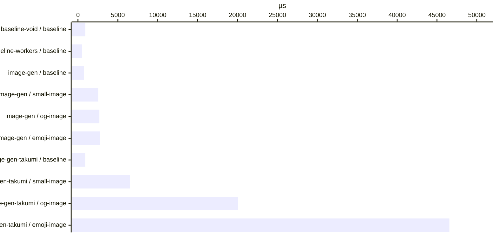

##### Wall time

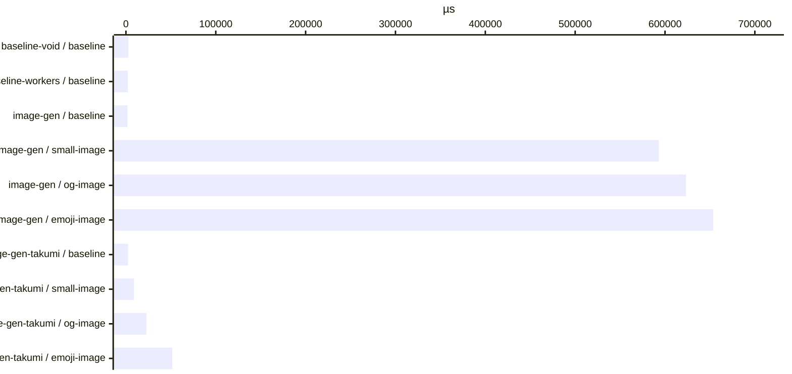

##### Isolate memory

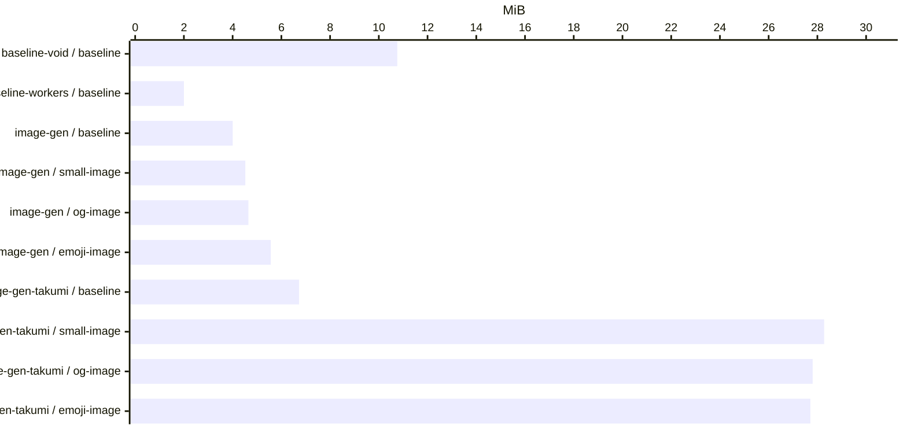

| Benchmark / workload           | CPU       | Wall time  | Isolate memory |
| ------------------------------ | --------- | ---------- | -------------- |
| baseline-void / baseline       | 914 µs    | 2,729 µs   | 10.758 MiB     |
| baseline-workers / baseline    | 506 µs    | 2,087 µs   | 2 MiB          |
| image-gen / baseline           | 768 µs    | 1,736 µs   | 4.004 MiB      |
| image-gen / small-image        | 2,540 µs  | 593,117 µs | 4.521 MiB      |
| image-gen / og-image           | 2,680 µs  | 623,319 µs | 4.647 MiB      |
| image-gen / emoji-image        | 2,729 µs  | 653,603 µs | 5.567 MiB      |
| image-gen-takumi / baseline    | 906 µs    | 2,330 µs   | 6.725 MiB      |
| image-gen-takumi / small-image | 6,512 µs  | 8,869 µs   | 28.277 MiB     |
| image-gen-takumi / og-image    | 20,080 µs | 22,787 µs  | 27.806 MiB     |
| image-gen-takumi / emoji-image | 46,562 µs | 51,482 µs  | 27.714 MiB     |

#### P99

##### CPU

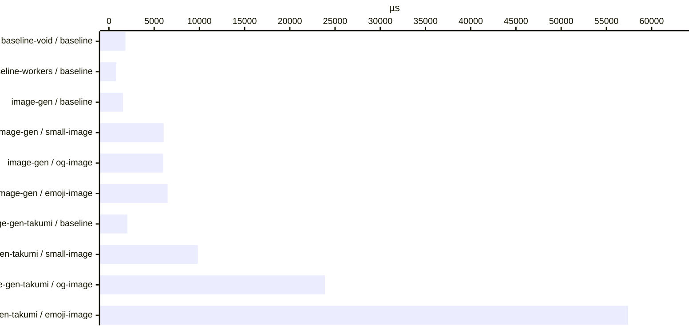

##### Wall time

```mermaid
---
config:
  xyChart:
    width: 1100
    height: 520
---
xychart-beta horizontal
    x-axis ["baseline-void / baseline", "baseline-workers / baseline", "image-gen / baseline", "image-gen / small-image", "image-gen / og-image", "image-gen / emoji-image", "image-gen-takumi / baseline", "image-gen-takumi / small-image", "image-gen-takumi / og-image", "image-gen-takumi / emoji-image"]
    y-axis "µs" 0 --> 966975.9
    bar [6093, 4284, 3527, 841615, 879069, 854029, 5587, 14415, 31415, 70609]
```

##### Isolate memory

```mermaid
---
config:
  xyChart:
    width: 1100
    height: 520
---
xychart-beta horizontal
    x-axis ["baseline-void / baseline", "baseline-workers / baseline", "image-gen / baseline", "image-gen / small-image", "image-gen / og-image", "image-gen / emoji-image", "image-gen-takumi / baseline", "image-gen-takumi / small-image", "image-gen-takumi / og-image", "image-gen-takumi / emoji-image"]
    y-axis "MiB" 0 --> 44.834198
    bar [12.507824, 2.5000114, 4.7539177, 5.5271034, 5.4507351, 6.3545799, 12.643368, 40.363359, 40.39888, 40.758362]
```

| Benchmark / workload           | CPU       | Wall time  | Isolate memory |
| ------------------------------ | --------- | ---------- | -------------- |
| baseline-void / baseline       | 1,826 µs  | 6,093 µs   | 12.508 MiB     |
| baseline-workers / baseline    | 816 µs    | 4,284 µs   | 2.5 MiB        |
| image-gen / baseline           | 1,551 µs  | 3,527 µs   | 4.754 MiB      |
| image-gen / small-image        | 6,053 µs  | 841,615 µs | 5.527 MiB      |
| image-gen / og-image           | 6,008 µs  | 879,069 µs | 5.451 MiB      |
| image-gen / emoji-image        | 6,493 µs  | 854,029 µs | 6.355 MiB      |
| image-gen-takumi / baseline    | 2,048 µs  | 5,587 µs   | 12.643 MiB     |
| image-gen-takumi / small-image | 9,828 µs  | 14,415 µs  | 40.363 MiB     |
| image-gen-takumi / og-image    | 23,882 µs | 31,415 µs  | 40.399 MiB     |
| image-gen-takumi / emoji-image | 57,405 µs | 70,609 µs  | 40.758 MiB     |

#### P99.9

##### CPU

```mermaid
---
config:
  xyChart:
    width: 1100
    height: 520
---
xychart-beta horizontal
    x-axis ["baseline-void / baseline", "baseline-workers / baseline", "image-gen / baseline", "image-gen / small-image", "image-gen / og-image", "image-gen / emoji-image", "image-gen-takumi / baseline", "image-gen-takumi / small-image", "image-gen-takumi / og-image", "image-gen-takumi / emoji-image"]
    y-axis "µs" 0 --> 123833.6
    bar [8771, 1697, 5737, 11001, 11576, 11843, 8316, 16665, 30641, 112576]
```

##### Wall time

```mermaid
---
config:
  xyChart:
    width: 1100
    height: 520
---
xychart-beta horizontal
    x-axis ["baseline-void / baseline", "baseline-workers / baseline", "image-gen / baseline", "image-gen / small-image", "image-gen / og-image", "image-gen / emoji-image", "image-gen-takumi / baseline", "image-gen-takumi / small-image", "image-gen-takumi / og-image", "image-gen-takumi / emoji-image"]
    y-axis "µs" 0 --> 9886015.7
    bar [13021, 8047, 9130, 3410177, 5871945, 8987287, 13502, 49212, 40709, 131008]
```

##### Isolate memory

```mermaid
---
config:
  xyChart:
    width: 1100
    height: 520
---
xychart-beta horizontal
    x-axis ["baseline-void / baseline", "baseline-workers / baseline", "image-gen / baseline", "image-gen / small-image", "image-gen / og-image", "image-gen / emoji-image", "image-gen-takumi / baseline", "image-gen-takumi / small-image", "image-gen-takumi / og-image", "image-gen-takumi / emoji-image"]
    y-axis "MiB" 0 --> 45.143468
    bar [12.757824, 2.5000114, 5.0039177, 5.7788391, 5.4777508, 6.5112457, 12.893368, 40.862858, 40.407585, 41.039516]
```

| Benchmark / workload           | CPU        | Wall time    | Isolate memory |
| ------------------------------ | ---------- | ------------ | -------------- |
| baseline-void / baseline       | 8,771 µs   | 13,021 µs    | 12.758 MiB     |
| baseline-workers / baseline    | 1,697 µs   | 8,047 µs     | 2.5 MiB        |
| image-gen / baseline           | 5,737 µs   | 9,130 µs     | 5.004 MiB      |
| image-gen / small-image        | 11,001 µs  | 3,410,177 µs | 5.779 MiB      |
| image-gen / og-image           | 11,576 µs  | 5,871,945 µs | 5.478 MiB      |
| image-gen / emoji-image        | 11,843 µs  | 8,987,287 µs | 6.511 MiB      |
| image-gen-takumi / baseline    | 8,316 µs   | 13,502 µs    | 12.893 MiB     |
| image-gen-takumi / small-image | 16,665 µs  | 49,212 µs    | 40.863 MiB     |
| image-gen-takumi / og-image    | 30,641 µs  | 40,709 µs    | 40.408 MiB     |
| image-gen-takumi / emoji-image | 112,576 µs | 131,008 µs   | 41.04 MiB      |

</details>

## Details

<details>
<summary>Show details</summary>

### Comparison context

Reports may have been collected at different times, on different machines, or with different workloads and settings. Shared caches, network conditions, and Cloudflare load affect results. These charts are descriptive comparisons, not statistical significance tests or performance rankings.

Missing measurements are omitted from charts and shown as Unavailable in the value tables, never plotted as zero. See each linked report for confidence intervals, environment context, and full methodology. Deployment-only snapshots contribute only bundle sizes and deployment timings.

Regenerate from the repository root with `vp run --filter ./benchmark compare`. Only adjacent saved report snapshots are read; no private artifacts or live services are needed.

</details>
