# Workers benchmark comparison

Overview of the latest saved benchmark reports. Lower is better except throughput, where higher is better.

## Benchmarks

| Benchmark                                                  | Measured (UTC)           | Data                                               |
| ---------------------------------------------------------- | ------------------------ | -------------------------------------------------- |
| [baseline-void](./baseline-void/report.md)                 | 2026-11-17T03:17:44.865Z | [report.json](./baseline-void/report.json)         |
| [baseline-workers](./baseline-workers/report.md)           | 2026-11-17T03:04:55.867Z | [report.json](./baseline-workers/report.json)      |
| [image-gen](./image-gen/report.md)                         | 2026-11-18T07:13:14.979Z | [report.json](./image-gen/report.json)             |
| [image-gen-bare-takumi](./image-gen-bare-takumi/report.md) | 2026-11-17T04:18:13.658Z | [report.json](./image-gen-bare-takumi/report.json) |
| [image-gen-takumi](./image-gen-takumi/report.md)           | 2026-11-17T06:59:17.908Z | [report.json](./image-gen-takumi/report.json)      |

## Bundle size

### Raw

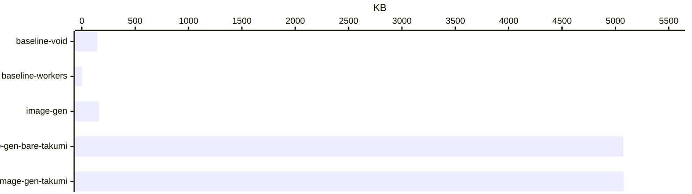

### Gzip

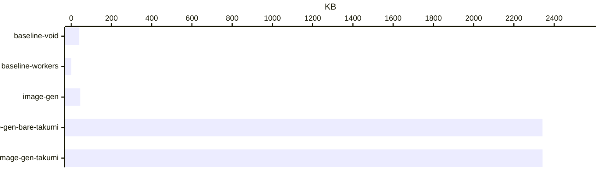

### Details

<details>
<summary>Show details</summary>

#### Values

| Benchmark / workload  | Raw          | Gzip         |
| --------------------- | ------------ | ------------ |
| baseline-void         | 142.649 KB   | 39.872 KB    |
| baseline-workers      | 0.187 KB     | 0.161 KB     |
| image-gen             | 159.47 KB    | 45.464 KB    |
| image-gen-bare-takumi | 5,076.039 KB | 2,341.931 KB |
| image-gen-takumi      | 5,077.982 KB | 2,342.532 KB |

#### Methodology

Median raw and gzip sizes across successful deployments with recorded sizes, in KB (1 KB = 1,000 bytes). Historical single-deployment reports use the recorded size.

</details>

## Deployment timing

### Build

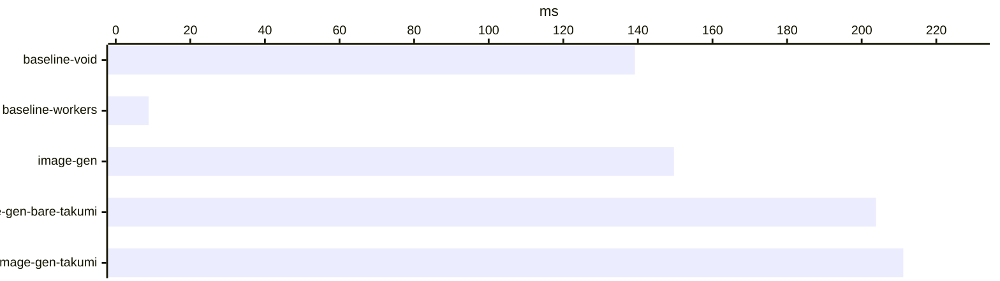

### Upload

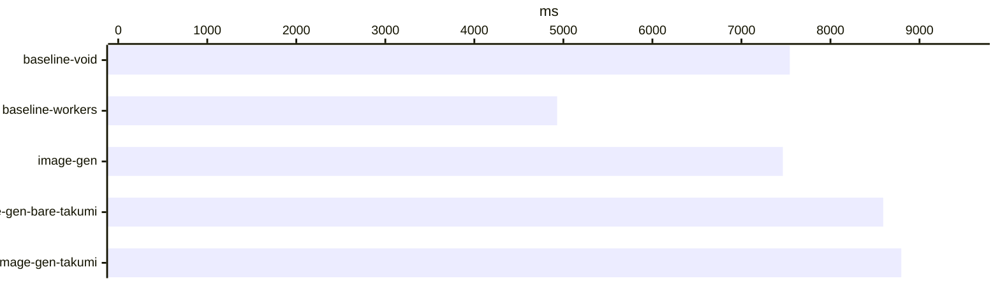

### Worker startup

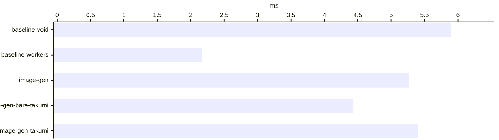

### `cf deploy`

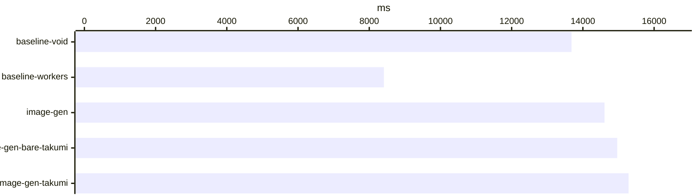

### Details

<details>
<summary>Show details</summary>

#### Values

| Benchmark / workload  | Build      | Upload       | Worker startup | `cf deploy`   |
| --------------------- | ---------- | ------------ | -------------- | ------------- |
| baseline-void         | 139.2 ms   | 7,543 ms     | 5.9 ms         | 13,680.044 ms |
| baseline-workers      | 8.833 ms   | 4,930.333 ms | 2.167 ms       | 8,411.52 ms   |
| image-gen             | 149.667 ms | 7,465.667 ms | 5.267 ms       | 14,607.731 ms |
| image-gen-bare-takumi | 203.867 ms | 8,592.333 ms | 4.433 ms       | 14,963.854 ms |
| image-gen-takumi      | 211.167 ms | 8,795.667 ms | 5.4 ms         | 15,283.349 ms |

#### Methodology

Means across successful deployment runs; historical single-deployment reports use the recorded timing. These phases overlap: do not add them. `cf deploy` includes build but excludes later Worker lookup and Access setup. Worker startup is runtime initialization, not cold-request latency.

</details>

## Latency

### Mean

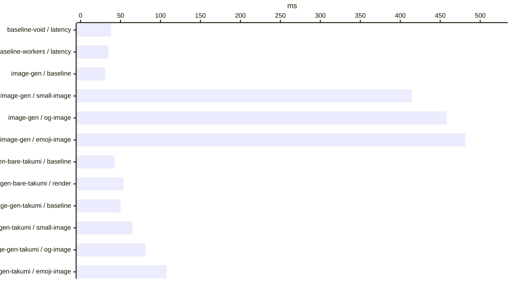

### Minimum

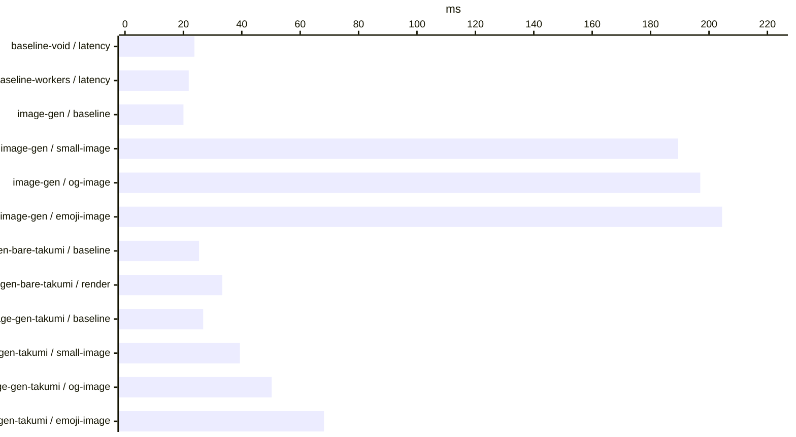

### P50

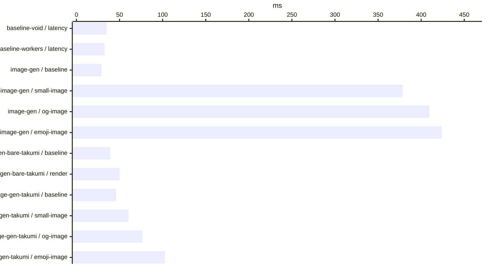

### P95

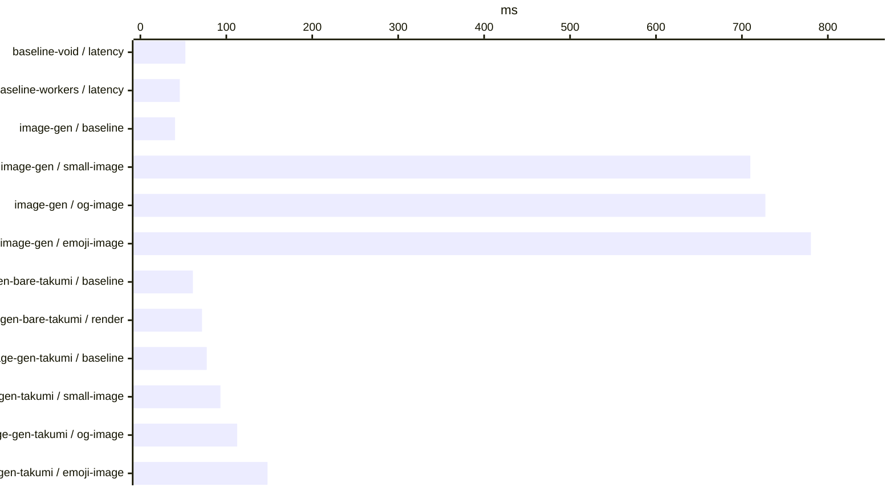

### P99

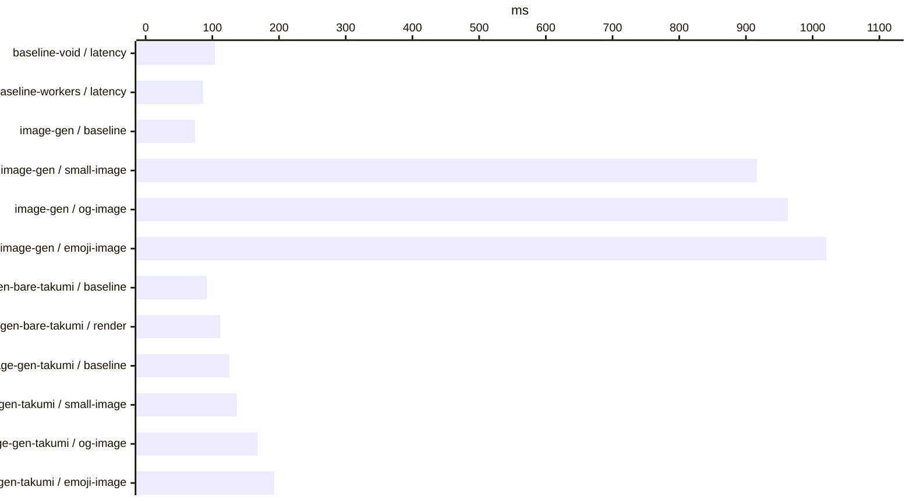

### Maximum

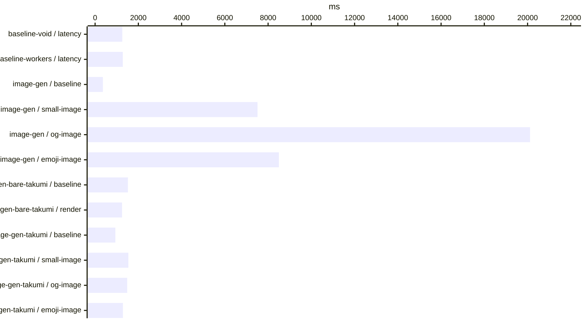

### Throughput

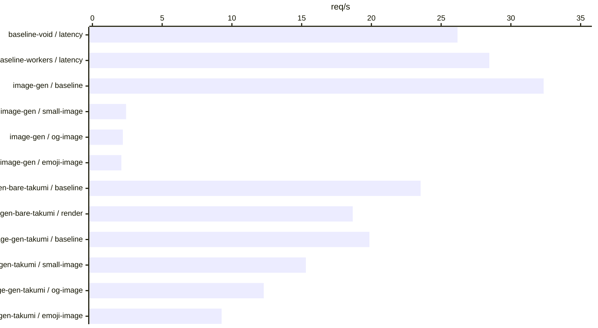

### Details

<details>
<summary>Show details</summary>

#### Values

| Benchmark / workload             | Mean       | Minimum    | P50        | P95        | P99          | Maximum       | Throughput   |
| -------------------------------- | ---------- | ---------- | ---------- | ---------- | ------------ | ------------- | ------------ |
| baseline-void / latency          | 38.183 ms  | 23.777 ms  | 34.9 ms    | 52.354 ms  | 104.2 ms     | 1,256.625 ms  | 26.174 req/s |
| baseline-workers / latency       | 35.121 ms  | 21.831 ms  | 32.609 ms  | 45.887 ms  | 85.976 ms    | 1,282.302 ms  | 28.455 req/s |
| image-gen / baseline             | 30.897 ms  | 20.033 ms  | 28.991 ms  | 40.367 ms  | 74.02 ms     | 358.793 ms    | 32.349 req/s |
| image-gen / small-image          | 414.293 ms | 189.471 ms | 378.6 ms   | 709.726 ms | 916.747 ms   | 7,510.015 ms  | 2.414 req/s  |
| image-gen / og-image             | 457.923 ms | 197.01 ms  | 409.524 ms | 727.294 ms | 962.676 ms   | 20,115.651 ms | 2.184 req/s  |
| image-gen / emoji-image          | 481.419 ms | 204.473 ms | 423.906 ms | 780.313 ms | 1,020.498 ms | 8,499.572 ms  | 2.077 req/s  |
| image-gen-bare-takumi / baseline | 42.477 ms  | 25.37 ms   | 39.187 ms  | 61.129 ms  | 91.51 ms     | 1,517.031 ms  | 23.528 req/s |
| image-gen-bare-takumi / render   | 53.556 ms  | 33.282 ms  | 50.106 ms  | 71.704 ms  | 111.615 ms   | 1,245.402 ms  | 18.662 req/s |
| image-gen-takumi / baseline      | 50.328 ms  | 26.783 ms  | 46.008 ms  | 77.235 ms  | 125.645 ms   | 936.569 ms    | 19.858 req/s |
| image-gen-takumi / small-image   | 65.315 ms  | 39.368 ms  | 60.356 ms  | 93.155 ms  | 136.818 ms   | 1,539.108 ms  | 15.303 req/s |
| image-gen-takumi / og-image      | 81.367 ms  | 50.248 ms  | 76.305 ms  | 112.691 ms | 168.154 ms   | 1,484.766 ms  | 12.285 req/s |
| image-gen-takumi / emoji-image   | 107.919 ms | 68.133 ms  | 102.757 ms | 147.95 ms  | 192.632 ms   | 1,287.151 ms  | 9.264 req/s  |

#### Methodology

Client latency includes network and Access overhead. Values describe pooled requests where available; throughput at the recorded concurrency is not capacity. Different routes, payloads, connection counts, or request settings are not equivalent workloads.

#### Workload context

| Benchmark / workload             | Request                                                                                                          | Rounds | Requests / duration per round | Connections | Rate limit |
| -------------------------------- | ---------------------------------------------------------------------------------------------------------------- | ------ | ----------------------------- | ----------- | ---------- |
| baseline-void / latency          | GET /                                                                                                            | 10     | 500                           | 1           | None       |
| baseline-workers / latency       | GET /                                                                                                            | 10     | 500                           | 1           | None       |
| image-gen / baseline             | GET /                                                                                                            | 10     | 500                           | 1           | None       |
| image-gen / small-image          | GET /run?width=64&amp;height=64                                                                                  | 10     | 500                           | 1           | None       |
| image-gen / og-image             | GET /run?width=1200&amp;height=630                                                                               | 10     | 500                           | 1           | None       |
| image-gen / emoji-image          | GET /run?width=1200&amp;height=630&amp;text=Hello%20%F0%9F%91%8B%20%F0%9F%8C%8D%20%F0%9F%9A%80                   | 10     | 500                           | 1           | None       |
| image-gen-bare-takumi / baseline | GET /                                                                                                            | 10     | 500                           | 1           | None       |
| image-gen-bare-takumi / render   | GET /run                                                                                                         | 10     | 500                           | 1           | None       |
| image-gen-takumi / baseline      | GET /                                                                                                            | 10     | 500                           | 1           | None       |
| image-gen-takumi / small-image   | GET /run?width=64&amp;height=64                                                                                  | 10     | 500                           | 1           | None       |
| image-gen-takumi / og-image      | GET /run?width=1200&amp;height=630                                                                               | 10     | 500                           | 1           | None       |
| image-gen-takumi / emoji-image   | GET /run?width=1200&amp;height=630&amp;text=Hello%20%F0%9F%91%8B%20%F0%9F%8C%8D%20%F0%9F%9A%80&amp;emoji=twemoji | 10     | 500                           | 1           | None       |

</details>

## Worker metrics (P50)

### CPU

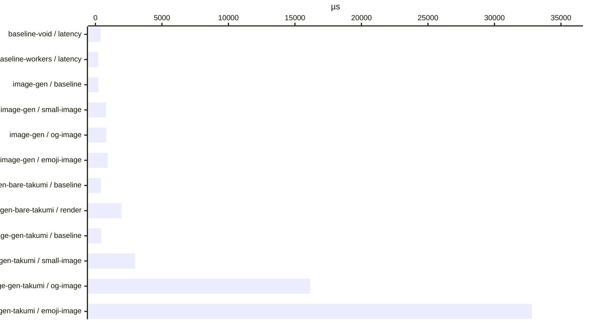

### Wall time

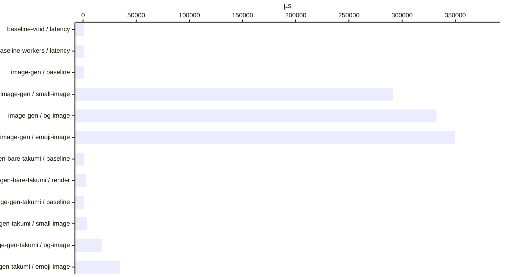

### Isolate memory

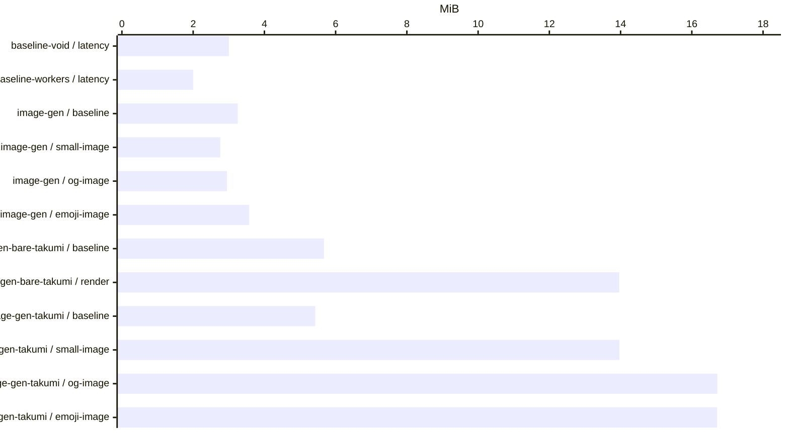

### Details

<details>
<summary>Show details</summary>

#### Values

| Benchmark / workload             | CPU       | Wall time  | Isolate memory |
| -------------------------------- | --------- | ---------- | -------------- |
| baseline-void / latency          | 391 µs    | 971 µs     | 3.004 MiB      |
| baseline-workers / latency       | 210 µs    | 816 µs     | 2 MiB          |
| image-gen / baseline             | 233 µs    | 534 µs     | 3.254 MiB      |
| image-gen / small-image          | 791 µs    | 291,821 µs | 2.763 MiB      |
| image-gen / og-image             | 819 µs    | 332,440 µs | 2.948 MiB      |
| image-gen / emoji-image          | 920 µs    | 349,782 µs | 3.574 MiB      |
| image-gen-bare-takumi / baseline | 404 µs    | 996 µs     | 5.673 MiB      |
| image-gen-bare-takumi / render   | 1,961 µs  | 2,691 µs   | 13.963 MiB     |
| image-gen-takumi / baseline      | 446 µs    | 1,110 µs   | 5.427 MiB      |
| image-gen-takumi / small-image   | 2,984 µs  | 3,932 µs   | 13.967 MiB     |
| image-gen-takumi / og-image      | 16,137 µs | 17,531 µs  | 16.715 MiB     |
| image-gen-takumi / emoji-image   | 32,814 µs | 34,667 µs  | 16.709 MiB     |

#### Methodology

CPU excludes time waiting on I/O. Wall time includes I/O waits and `waitUntil()` work, not client response time. Memory is shared isolate usage, not per-request allocation or peak memory. Quantiles are sampled across each Worker and its padded measurement window, including warmups. Raw CPU and wall-time quantiles are microseconds; memory bytes are converted to MiB.

#### P90

##### CPU

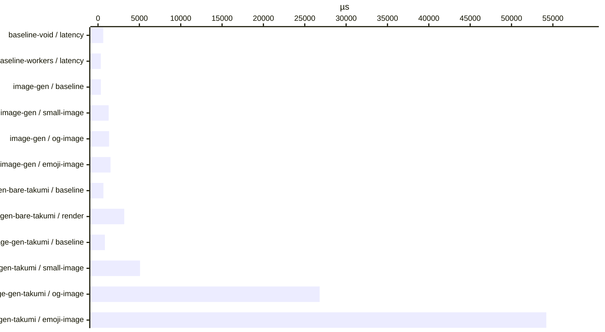

##### Wall time

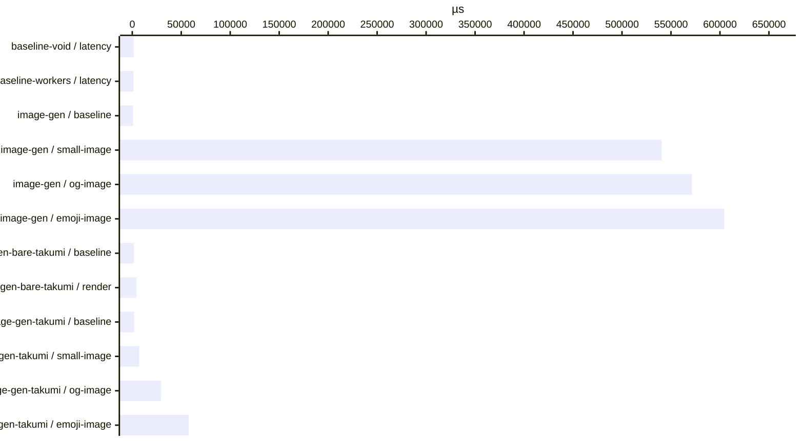

##### Isolate memory

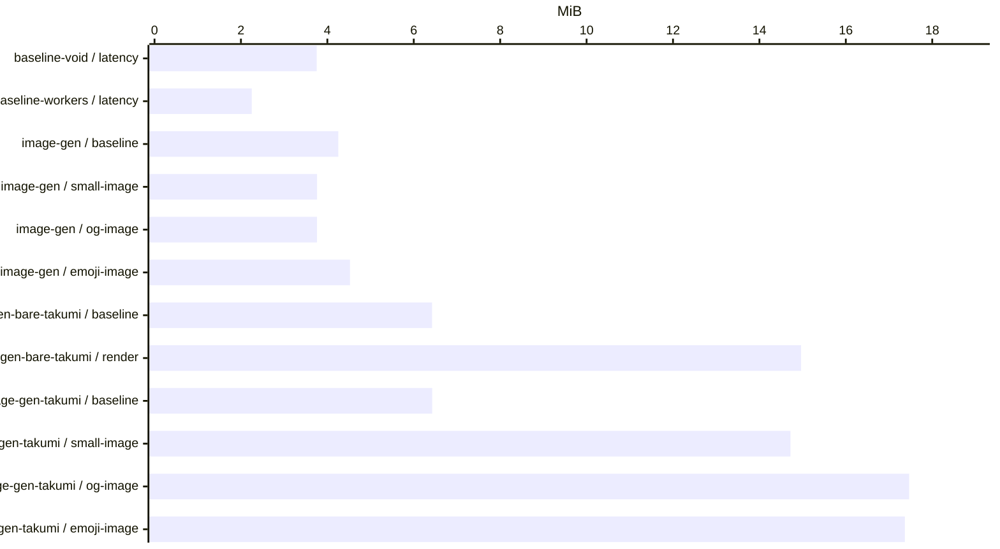

| Benchmark / workload             | CPU       | Wall time  | Isolate memory |
| -------------------------------- | --------- | ---------- | -------------- |
| baseline-void / latency          | 629 µs    | 1,542 µs   | 3.754 MiB      |
| baseline-workers / latency       | 337 µs    | 1,285 µs   | 2.25 MiB       |
| image-gen / baseline             | 348 µs    | 825 µs     | 4.254 MiB      |
| image-gen / small-image          | 1,287 µs  | 540,568 µs | 3.762 MiB      |
| image-gen / og-image             | 1,339 µs  | 571,334 µs | 3.76 MiB       |
| image-gen / emoji-image          | 1,516 µs  | 604,515 µs | 4.523 MiB      |
| image-gen-bare-takumi / baseline | 653 µs    | 1,667 µs   | 6.423 MiB      |
| image-gen-bare-takumi / render   | 3,173 µs  | 4,427 µs   | 14.964 MiB     |
| image-gen-takumi / baseline      | 833 µs    | 1,981 µs   | 6.427 MiB      |
| image-gen-takumi / small-image   | 5,077 µs  | 7,033 µs   | 14.719 MiB     |
| image-gen-takumi / og-image      | 26,801 µs | 29,541 µs  | 17.465 MiB     |
| image-gen-takumi / emoji-image   | 54,208 µs | 57,758 µs  | 17.366 MiB     |

#### P99

##### CPU

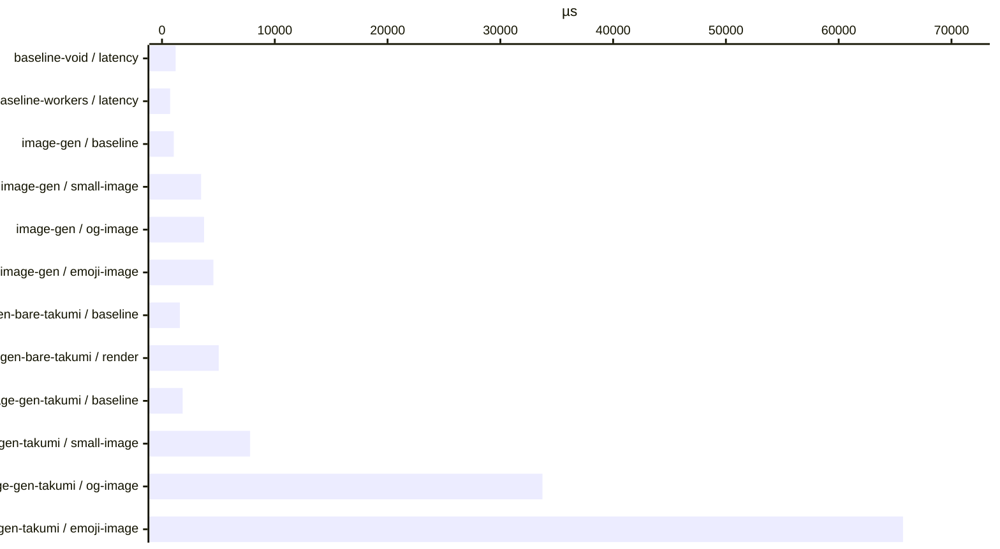

##### Wall time

```mermaid
---
config:
  xyChart:
    width: 1100
    height: 604
---
xychart-beta horizontal
    x-axis ["baseline-void / latency", "baseline-workers / latency", "image-gen / baseline", "image-gen / small-image", "image-gen / og-image", "image-gen / emoji-image", "image-gen-bare-takumi / baseline", "image-gen-bare-takumi / render", "image-gen-takumi / baseline", "image-gen-takumi / small-image", "image-gen-takumi / og-image", "image-gen-takumi / emoji-image"]
    y-axis "µs" 0 --> 1000060.6
    bar [3252, 2133, 2107, 807640, 859967, 909146, 3111, 7294, 3883, 11751, 38438, 73909]
```

##### Isolate memory

```mermaid
---
config:
  xyChart:
    width: 1100
    height: 604
---
xychart-beta horizontal
    x-axis ["baseline-void / latency", "baseline-workers / latency", "image-gen / baseline", "image-gen / small-image", "image-gen / og-image", "image-gen / emoji-image", "image-gen-bare-takumi / baseline", "image-gen-bare-takumi / render", "image-gen-takumi / baseline", "image-gen-takumi / small-image", "image-gen-takumi / og-image", "image-gen-takumi / emoji-image"]
    y-axis "MiB" 0 --> 20.041957
    bar [4.2539177, 2.5000114, 5.0039177, 4.5124359, 4.9425144, 5.4389153, 6.6733665, 15.715374, 6.9272728, 15.22042, 18.219961, 17.876713]
```

| Benchmark / workload             | CPU       | Wall time  | Isolate memory |
| -------------------------------- | --------- | ---------- | -------------- |
| baseline-void / latency          | 1,211 µs  | 3,252 µs   | 4.254 MiB      |
| baseline-workers / latency       | 717 µs    | 2,133 µs   | 2.5 MiB        |
| image-gen / baseline             | 1,044 µs  | 2,107 µs   | 5.004 MiB      |
| image-gen / small-image          | 3,467 µs  | 807,640 µs | 4.512 MiB      |
| image-gen / og-image             | 3,728 µs  | 859,967 µs | 4.943 MiB      |
| image-gen / emoji-image          | 4,558 µs  | 909,146 µs | 5.439 MiB      |
| image-gen-bare-takumi / baseline | 1,585 µs  | 3,111 µs   | 6.673 MiB      |
| image-gen-bare-takumi / render   | 5,030 µs  | 7,294 µs   | 15.715 MiB     |
| image-gen-takumi / baseline      | 1,832 µs  | 3,883 µs   | 6.927 MiB      |
| image-gen-takumi / small-image   | 7,813 µs  | 11,751 µs  | 15.22 MiB      |
| image-gen-takumi / og-image      | 33,733 µs | 38,438 µs  | 18.22 MiB      |
| image-gen-takumi / emoji-image   | 65,703 µs | 73,909 µs  | 17.877 MiB     |

#### P99.9

##### CPU

```mermaid
---
config:
  xyChart:
    width: 1100
    height: 604
---
xychart-beta horizontal
    x-axis ["baseline-void / latency", "baseline-workers / latency", "image-gen / baseline", "image-gen / small-image", "image-gen / og-image", "image-gen / emoji-image", "image-gen-bare-takumi / baseline", "image-gen-bare-takumi / render", "image-gen-takumi / baseline", "image-gen-takumi / small-image", "image-gen-takumi / og-image", "image-gen-takumi / emoji-image"]
    y-axis "µs" 0 --> 86065.1
    bar [4437, 1007, 3279, 7371, 7349, 8682, 5054, 8779, 5053, 11758, 41315, 78241]
```

##### Wall time

```mermaid
---
config:
  xyChart:
    width: 1100
    height: 604
---
xychart-beta horizontal
    x-axis ["baseline-void / latency", "baseline-workers / latency", "image-gen / baseline", "image-gen / small-image", "image-gen / og-image", "image-gen / emoji-image", "image-gen-bare-takumi / baseline", "image-gen-bare-takumi / render", "image-gen-takumi / baseline", "image-gen-takumi / small-image", "image-gen-takumi / og-image", "image-gen-takumi / emoji-image"]
    y-axis "µs" 0 --> 4184183.3
    bar [6724, 5342, 4718, 2289296, 2212706, 3803803, 8555, 15791, 9128, 35738, 52201, 92433]
```

##### Isolate memory

```mermaid
---
config:
  xyChart:
    width: 1100
    height: 604
---
xychart-beta horizontal
    x-axis ["baseline-void / latency", "baseline-workers / latency", "image-gen / baseline", "image-gen / small-image", "image-gen / og-image", "image-gen / emoji-image", "image-gen-bare-takumi / baseline", "image-gen-bare-takumi / render", "image-gen-takumi / baseline", "image-gen-takumi / small-image", "image-gen-takumi / og-image", "image-gen-takumi / emoji-image"]
    y-axis "MiB" 0 --> 20.58705
    bar [4.5039177, 2.5000114, 5.0039177, 4.5268307, 5.6778641, 6.0058146, 6.6733665, 16.212811, 6.9272728, 15.97042, 18.7155, 18.387207]
```

| Benchmark / workload             | CPU       | Wall time    | Isolate memory |
| -------------------------------- | --------- | ------------ | -------------- |
| baseline-void / latency          | 4,437 µs  | 6,724 µs     | 4.504 MiB      |
| baseline-workers / latency       | 1,007 µs  | 5,342 µs     | 2.5 MiB        |
| image-gen / baseline             | 3,279 µs  | 4,718 µs     | 5.004 MiB      |
| image-gen / small-image          | 7,371 µs  | 2,289,296 µs | 4.527 MiB      |
| image-gen / og-image             | 7,349 µs  | 2,212,706 µs | 5.678 MiB      |
| image-gen / emoji-image          | 8,682 µs  | 3,803,803 µs | 6.006 MiB      |
| image-gen-bare-takumi / baseline | 5,054 µs  | 8,555 µs     | 6.673 MiB      |
| image-gen-bare-takumi / render   | 8,779 µs  | 15,791 µs    | 16.213 MiB     |
| image-gen-takumi / baseline      | 5,053 µs  | 9,128 µs     | 6.927 MiB      |
| image-gen-takumi / small-image   | 11,758 µs | 35,738 µs    | 15.97 MiB      |
| image-gen-takumi / og-image      | 41,315 µs | 52,201 µs    | 18.715 MiB     |
| image-gen-takumi / emoji-image   | 78,241 µs | 92,433 µs    | 18.387 MiB     |

</details>

## Details

<details>
<summary>Show details</summary>

### Comparison context

Reports may have been collected at different times, on different machines, or with different workloads and settings. Shared caches, network conditions, and Cloudflare load affect results. These charts are descriptive comparisons, not statistical significance tests or performance rankings.

Missing measurements are omitted from charts and shown as Unavailable in the value tables, never plotted as zero. See each linked report for confidence intervals, environment context, and full methodology. Deployment-only snapshots contribute only bundle sizes and deployment timings.

Regenerate from the repository root with `vp run --filter ./benchmark compare`. Only adjacent saved report snapshots are read; no private artifacts or live services are needed.

</details>
