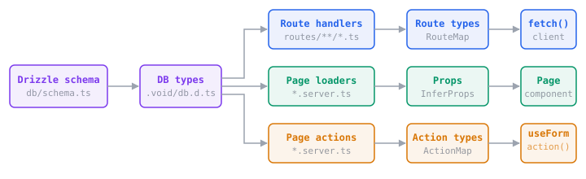

# Type Safety

Void infers types from your database schema, route handlers, and page loaders. When you change a field, TypeScript shows which queries, requests, and components need to change.

## The Type Pipeline



1. **Database types** come from your [Drizzle schema](./database.md#schema-definition). Column types are known at compile time.
2. **Route handlers:** return types and validator schemas become the generated `RouteMap`, which the [typed fetch](./typed-fetch) client consumes.
3. **Page loaders:** return types flow into page components as props via `InferProps`.
4. **Page actions:** validator schemas flow into `useForm` and `action()` for typed data, errors, and URL autocomplete.

All generated types live in `.void/` and update automatically when source files or schema change.

## Database → Handler → Client

Types flow from your Drizzle schema through handlers to the client without any manual annotations:

```ts
// routes/api/users.ts
export const GET = defineHandler(async (c) => {
  return db.select({ name: users.name, email: users.email }).from(users);
  //     ↑ return type inferred from schema columns
});

export const POST = defineHandler.withValidator({
  body: insertUserSchema, // ← derived from Drizzle schema
})(async (c, { body }) => {
  return db.insert(users).values(body).returning();
});
```

```ts
// Client: types inferred from handlers above
const users = await fetch('/api/users');
//    ↑ { name: string; email: string }[]

await fetch('/api/users', {
  method: 'POST',
  body: { name: 'Alice', email: 'alice@example.com' }, // ← typed from validator
});
```

The Drizzle schema defines database columns, runtime validation, handler input types, and client-side type checking all at once. For endpoints that don't map to a table, use any [Standard Schema](./server-routing.md#manual-validators) library.

## Loader → Page Props

In [pages mode](./pages-routing/overview), a loader's return type flows into the page component via `InferProps`:

```ts
// pages/users/index.server.ts
export type Props = InferProps<typeof loader>;

export const loader = defineHandler(async (c) => {
  return { users: await db.select().from(users) };
});
```

```vue
<!-- pages/users/index.vue -->
<script setup lang="ts">
import type { Props } from './index.server';
defineProps<Props>(); // ← { users: { id: number; name: string; ... }[] }
</script>
```

No manual interface is needed. Props stay in sync with whatever the loader returns.

## Action → useForm

When a page action uses `withValidator()`, the body schema flows through to `useForm`. That gives you typed `data`, typed `errors` keys, and URL autocomplete:

```ts
// pages/users/create.server.ts
export const action = defineHandler.withValidator({
  body: insertUserSchema,
})(async (c, { body }) => {
  await db.insert(users).values(body);
});
```

```ts
const form = useForm('/users/create', { name: '', email: '' });
//                    ^ autocompletes     ^ must match body schema

form.errors.email; // ✓ string | undefined
form.errors.foo; // ✗ TypeScript error
```

[Named actions](./pages-routing/actions-and-forms#named-actions) work the same way. The `?actionName` suffix selects the right types for that action:

```ts
const updateForm = useForm('/users/:id?update', { name: '' }, { params: { id } });
const deleteForm = useForm('/users/:id?delete', { id: '' }, { params: { id } });
// Each form's data and errors are typed from their respective validators
```

The `action()` helper gets the same type checking. See [Actions & Forms](./pages-routing/actions-and-forms) for the full API.

## What Gets Checked

| Layer        | What's type-checked                                                                                                   |
| ------------ | --------------------------------------------------------------------------------------------------------------------- |
| Database     | Table columns, value types, insert/update shapes from Drizzle schema                                                  |
| Handlers     | `c.env` bindings, validator input, return type                                                                        |
| Fetch client | Route paths, HTTP methods, `body`/`query`/`params`, response type                                                     |
| `useForm`    | Action URLs, `data` fields, `errors` keys, `reset()` args (including `{ initial: true }`), `params`, `resetOnSuccess` |
| `action()`   | Action URLs, `data` payload, `params`                                                                                 |

## Serialization

The client types reflect JSON serialization through `Serialize<T>`:

| Source type                       | Serialized type                                        |
| --------------------------------- | ------------------------------------------------------ |
| `string`, `number`, `boolean`     | unchanged                                              |
| `Date`                            | `string`                                               |
| `Response`                        | excluded (passed through at runtime)                   |
| `bigint`, `Function`, `undefined` | excluded                                               |
| `Array<T>` / `{ key: T }`         | recursively serialized (function-valued keys stripped) |

## Context Variables

Middleware and handlers share typed data through Hono's context variables. Augment `CloudContextVariables` to define your own:

```ts
// middleware/01.auth.ts
declare module 'void' {
  interface CloudContextVariables {
    requestId: string;
  }
}

export default defineMiddleware(async (c, next) => {
  c.set('requestId', crypto.randomUUID());
  await next();
});
```

Now `c.get("requestId")` returns `string` everywhere, with no assertion needed. Multiple augmentations across files are [merged together](https://www.typescriptlang.org/docs/handbook/declaration-merging.html).

## Setup

Extend the generated tsconfig in your project:

```json
{
  "extends": "./.void/tsconfig.json",
  "compilerOptions": {
    "target": "ES2022",
    "module": "ES2022",
    "moduleResolution": "bundler",
    "strict": true,
    "jsx": "react-jsx",
    "types": ["void/env"]
  },
  "include": ["src", "routes", "middleware", "crons", "queues"]
}
```

If you already have a TypeScript config, run `void init --tsconfig` to add Void types while preserving your settings.

Run `void prepare` in CI or after a fresh clone, or let `vite dev` / `vite build` generate the `.void/` files during normal app workflows.
