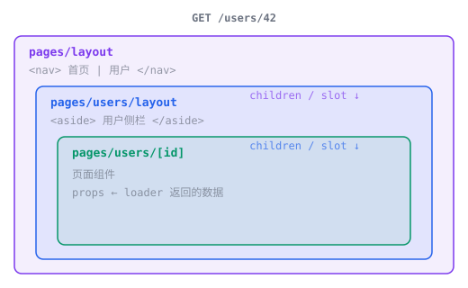

<script setup>
function layoutBasicItems(ext) {
  return [
    {
      name: "pages/",
      children: [
        { name: `layout${ext}`, description: "根布局（导航、页脚）" },
        { name: `index${ext}` },
        {
          name: "users/",
          children: [
            { name: `layout${ext}`, description: "/users/* 的嵌套布局" },
            { name: `index${ext}` },
            { name: `[id]${ext}` },
          ],
        },
      ],
    },
  ]
}

function namedLayoutItems(ext) {
  return [
    {
      name: "pages/",
      children: [
        {
          name: "_layouts/",
          children: [
            { name: `landing${ext}`, description: '名为 "landing" 的布局' },
            { name: `post${ext}`, description: '名为 "post" 的布局' },
          ],
        },
        { name: `layout${ext}`, description: "默认根布局" },
        { name: `index${ext}` },
        {
          name: "blog/",
          children: [
            { name: "hello.md", description: "layout: post" },
            { name: "archive.md", description: "layout: landing" },
          ],
        },
        { name: `pricing${ext}`, description: "layout: !landing (独占)" },
      ],
    },
  ]
}

</script>

# 布局与共享数据 {#layouts-shared-data}

使用布局放置导航、页眉，以及多个页面共用的其他 UI。布局会随目录结构嵌套，并在导航时保留组件状态。

## 布局 {#layouts}

在 `pages/` 目录中放置布局文件，即可包裹该目录下的页面：

<FileTree :items="layoutBasicItems" adapter-tabs default-expanded />

::: code-group

```tsx [React]
// pages/layout.tsx
import { useShared, Link } from '@void/react';

export default function Layout({ children }: { children: React.ReactNode }) {
  const { auth } = useShared();
  return (
    <>
      <nav>
        <Link href="/">Home</Link>
        <Link href="/users">Users</Link>
        {auth?.user && <span>{auth.user.name}</span>}
      </nav>
      <main>{children}</main>
    </>
  );
}
```

```vue [Vue]
<!-- pages/layout.vue -->
<script setup lang="ts">
import { useShared, Link } from '@void/vue';
const { auth } = useShared();
</script>

<template>
  <nav>
    <Link href="/">Home</Link>
    <Link href="/users">Users</Link>
    <span v-if="auth?.user">{{ auth.user.name }}</span>
  </nav>
  <main>
    <slot />
  </main>
</template>
```

```svelte [Svelte]
<!-- pages/layout.svelte -->
<script>
  import { useShared, Link } from "@void/svelte";
  let { children } = $props();
  const { auth } = useShared();
</script>

<nav>
  <Link href="/">Home</Link>
  <Link href="/users">Users</Link>
  {#if auth?.user}<span>{auth.user.name}</span>{/if}
</nav>
<main>
  {@render children()}
</main>
```

```tsx [Solid]
// pages/layout.tsx
import { useShared, Link } from '@void/solid';
import type { JSX } from 'solid-js';

export default function Layout(props: { children: JSX.Element }) {
  const shared = useShared();
  return (
    <>
      <nav>
        <Link href="/">Home</Link>
        <Link href="/users">Users</Link>
        {shared.auth?.user && <span>{shared.auth.user.name}</span>}
      </nav>
      <main>{props.children}</main>
    </>
  );
}
```

:::

页面渲染时，会由布局包裹。在 React、Solid 和 Svelte 中，页面组件作为布局的 children 传入；在 Vue 中，则通过插槽传入：



## 命名布局 {#named-layouts}

命名布局允许单个页面选择其他布局，同时保持 URL 结构不变。在 `pages/` 内的 `_layouts/` 目录中定义命名布局：

<FileTree :items="namedLayoutItems" adapter-tabs default-expanded />

### 选择命名布局 {#selecting-a-named-layout}

在任意页面中导出 `layout` 常量：

::: code-group

```tsx [React]
export const layout = 'landing';

export default function Page() {
  return <div>This page uses the landing layout</div>;
}
```

```vue [Vue]
<script>
export const layout = 'landing';
</script>

<template>
  <div>This page uses the landing layout</div>
</template>
```

```svelte [Svelte]
<script context="module">
export const layout = "landing";
</script>

<div>This page uses the landing layout</div>
```

```tsx [Solid]
export const layout = 'landing';

export default function Page() {
  return <div>This page uses the landing layout</div>;
}
```

:::

对于 Markdown 页面，使用 frontmatter：

```md
---
layout: post
---

# My Blog Post
```

### 布局模式 {#layout-modes}

| 值 | 行为 |
| --- | --- |
| `"landing"` | 替换布局链中最内层的布局，外层祖先布局仍然生效。 |
| `"!landing"` | 替换**整条**布局链，只有该命名布局包裹页面。 |
| `false` | 不使用任何布局包裹，页面独立渲染。 |

命名布局会替换最深层的默认布局：在 `[root, docs/layout]` 中替换 `docs/layout`，在 `[root]` 中则替换根布局。

Void 会从页面所在目录及其祖先目录中，选择最近且名称匹配的 `_layouts/` 文件。找不到命名布局时，构建会失败。

## 共享数据 {#shared-data}

中间件可以通过 `c.set("shared", {...})` 注入所有页面都能访问的数据。扩展 `CloudContextVariables` 来声明共享数据的类型，`useShared()` 就会自动推导类型：

```ts
// middleware/01.auth.ts
import { defineMiddleware } from 'void';
import { getUser, type AuthUser } from 'void/auth';

declare module 'void' {
  interface CloudContextVariables {
    shared: { auth: { user: AuthUser | null } };
  }
}

export default defineMiddleware(async (c, next) => {
  const user = getUser();
  c.set('shared', { auth: { user } });
  await next();
});
```

像上面的布局示例一样，从框架适配器调用 `useShared()`。它的返回类型根据 `CloudContextVariables` 推导。共享数据来自中间件，页面 props 来自 loader。见[上下文变量](/zh/guide/type-safety#context-variables)。
