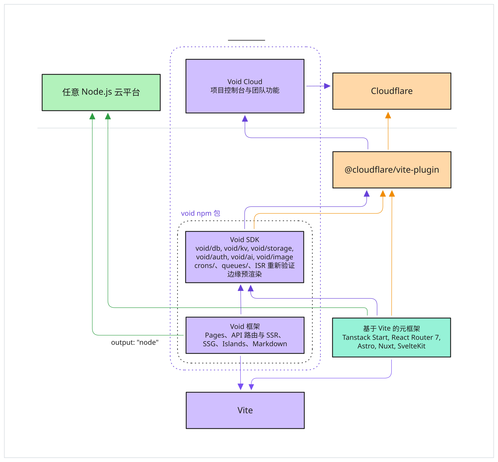

# 元框架 {#meta-frameworks}

保留框架原有的路由和渲染方式，通过 Void 添加数据库、存储、定时任务和部署功能。本节介绍各个框架与 Void 的集成方法。

将 `voidPlugin()` 添加到框架的 Vite 配置中，它会检测资源使用情况、生成数据库类型、管理迁移，并为运行 `void deploy` 做好准备。

TanStack Start 和 React Router 使用 Void 提供的 Cloudflare Vite 插件。SvelteKit、Nuxt、Analog 和 Astro 则使用各自的 Cloudflare 适配器。虽然配置方式不同，路由和渲染仍由各框架负责。



## 支持的框架 {#supported-frameworks}

| 框架                                  | 包名                    | 集成方式                                                                     |
| ------------------------------------- | ----------------------- | ---------------------------------------------------------------------------- |
| [TanStack Start](/zh/integrations/frameworks/tanstack-start) | `@tanstack/react-start` | 组合 Vite 插件，`voidPlugin()` 与框架插件配合使用 |
| [React Router v7](/zh/integrations/frameworks/react-router) | `@react-router/dev` | 组合 Vite 插件，配置方式与 TanStack Start 相同 |
| [SvelteKit](/zh/integrations/frameworks/sveltekit) | `@sveltejs/kit` | 基于 Vite，使用自身的 Cloudflare 适配器 |
| [Nuxt](/zh/integrations/frameworks/nuxt) | `nuxt` | 使用自身的 CLI 和构建工具链 |
| [Analog](/zh/integrations/frameworks/analog) | `@analogjs/platform` | 基于 Vite，使用 Nitro 的 Cloudflare 预设 |
| [Astro **v6+**](/zh/integrations/frameworks/astro) | `astro` | 使用自身的 CLI 和 Cloudflare 适配器，要求 v6 或更高版本 |

CLI 会读取 `package.json` 中的依赖，自动识别框架。

## 支持的功能 {#feature-support}

将 `voidPlugin()` 添加到框架的 Vite 配置后，即可使用 [Void 应用](/zh/guide/app-types#void-apps)的大部分后端与平台功能：

- **绑定推断：**从源码中检测 D1、KV、R2、AI 和队列的使用情况。
- **类型化数据库：**根据 Drizzle schema 生成查询类型。
- **迁移：**启动开发服务器时更新本地 D1；运行 `void deploy` 时校验并部署迁移。
- **运行时辅助函数：**通过 `void/db`、`void/kv`、`void/storage` 和 `void/ai`，在开发和生产环境中以类型安全的方式访问 Cloudflare 绑定。
- **身份验证：**框架模式暂不支持由 Void 管理的身份验证，请使用 Better Auth 为相应框架提供的官方集成。
- **定时任务：**通过 `crons/` 目录定义定时执行的处理函数。
- **队列消费者：**通过 `queues/` 目录定义带类型的生产者和消费者。
- **缓存重新验证与预渲染：**在 `void.config.ts` 中配置 [`routing.revalidate`](/zh/guide/edge/revalidation) 和 [`routing.prerender`](/zh/guide/edge/prerendering)。Void 应用还可以在配套的 `.server.ts` 文件中按页面配置。

对于框架应用，无论使用 `void deploy` 还是 `void deploy --platform cloudflare` 部署，Void 的缓存重新验证都会缓存公开的 HTML 文档响应。客户端数据请求仍按框架自身的方式处理。带有 `Set-Cookie` 响应头，或 `Cache-Control: private`、`no-store`、`no-cache` 缓存指令的响应不会共享。

你也可以通过框架自身的方式直接访问绑定。例如，SvelteKit 3 和 Analog 使用 `cloudflare:workers` 中的 `env`，SvelteKit 2 使用 `platform.env`，Nuxt 使用 `event.context.cloudflare.env`，Astro 使用 `Astro.locals.runtime.env`。

## 配置 {#configuration}

### `void.config.ts` {#void-config-ts}

大部分配置会自动推断。通过 `void.config.ts` 可以覆盖默认值或调整具体行为：

```ts
import { defineConfig } from 'void/config';

export default defineConfig({
  inference: {
    build: 'nuxt build',
    scanDirs: ['src', 'server', 'lib'],
    bindings: { db: 'MY_DB' },
  },
  routing: {
    prerender: ['/', '/about', '/pricing'],
    revalidate: 60,
  },
});
```

| 字段                 | 用途                                                                                                                                                          |
| -------------------- | ------------------------------------------------------------------------------------------------------------------------------------------------------------- |
| `inference.build`    | 覆盖默认构建命令 |
| `inference.scanDirs` | 绑定推断时扫描的目录，默认值因框架而异 |
| `routing.prerender`  | 部署时预渲染为静态 HTML 的路径 |
| `routing.revalidate` | 缓存响应默认的重新验证 TTL，单位为秒 |
| `inference.bindings` | 覆盖推断出的绑定，仅在自动检测结果不符合需要时使用。接受 `true` 或自定义绑定名称，例如 `"db": "MY_DB"` |
| `routing.notFound`   | **会被忽略。** SvelteKit、Nuxt、Analog 和 Astro 将 `not_found_handling` 固定为 `"none"`，由框架的 Worker 处理未匹配到路由的 HTML 请求。设置此项时，`void deploy` 会发出警告 |

完整说明请参阅[配置](/zh/reference/config)。

### Cloudflare 设置 {#cloudflare-settings}

使用 Cloudflare 开发运行时的框架，需要将适配器指向 Void 生成的 `.void-wrangler.jsonc`。各框架的配置指南会说明对应的适配器选项。在 `void.config.ts` 中定义 Cloudflare 设置：

```ts
import { defineConfig } from 'void/config';

export default defineConfig({
  cloudflare: {
    name: 'my-app',
    compatibility_date: '2026-02-24',
    compatibility_flags: ['nodejs_compat'],
  },
});
```

已有绑定会保留。部署前，D1、KV 和 R2 使用本地占位 ID。对于直接连接 Cloudflare 的项目，导入 `void/ai` 会在开发期间添加远程 Workers AI 绑定；使用前需要[登录 Cloudflare](/zh/guide/ai#local-development)。直接部署时也会包含推断出的 AI 绑定。

Void 会将这些设置与推断出的绑定合并，并在 `void.lock.json` 中记录已创建资源的 ID。请将这两个文件提交到版本控制。

## 部署 {#deployment}

运行 `void deploy`，即可使用框架的构建流程构建应用，并部署到所选目标。部署配置与 CI 的用法请参阅[部署应用](/zh/guide/deployment)。
